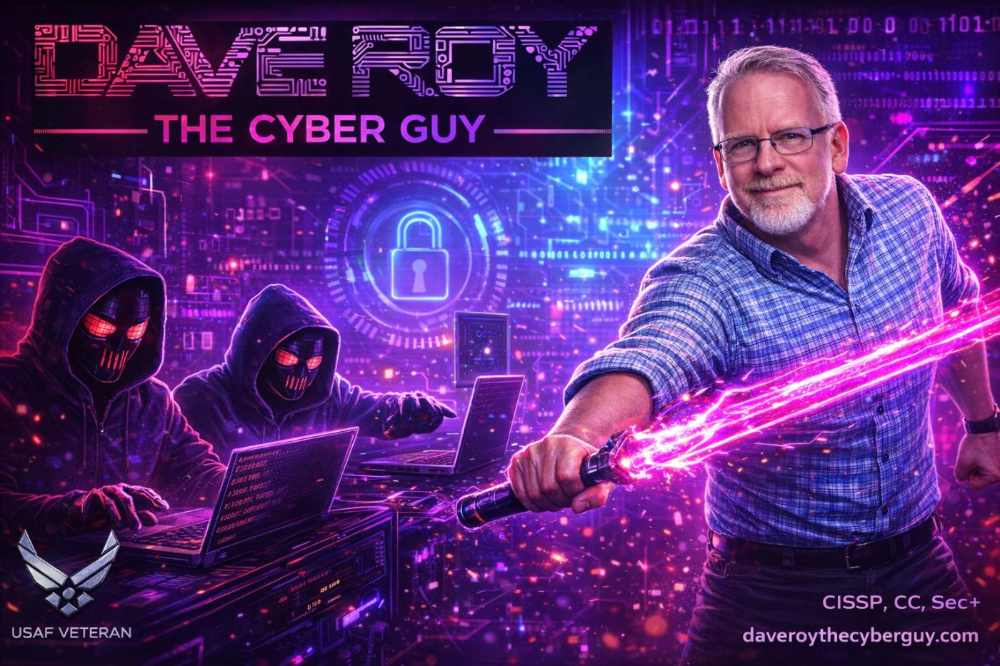

  
  <h1>Dave Roy | The Cyber Guy</h1>
  
<strong>USAF Veteran · Cybersecurity Strategy · AI & Post-Quantum Security</strong>

  

    
    
    
  

  

    
    
    
    
  

---

### 🛡️ About

I’m Dave Roy, a cybersecurity leader and U.S. Air Force veteran. I work across enterprise security architecture, cyber risk and GRC, Zero Trust, and critical infrastructure security. I’m especially interested in helping organizations make sound security decisions as AI and post-quantum technologies reshape the threat landscape.

This is my home for practical security tools, research, and learning resources. My approach is grounded in service, systems thinking, and making complex security challenges easier to act on.

### ⚡ Areas of focus

- **Security strategy:** enterprise architecture, GRC, cyber risk, and Zero Trust
- **Emerging technology:** AI security, responsible adoption, and post-quantum readiness
- **Resilience:** OT/ICS, critical infrastructure, and actionable threat intelligence

### 🌐 Explore daveroythecyberguy.com

- [Cybersecurity Hub](https://daveroythecyberguy.com/cyber-hub/) — defensive security news, guidance, and resources
- [AI Hub](https://daveroythecyberguy.com/ai-hub/) — AI developments, security, and learning
- [Quantum Hub](https://daveroythecyberguy.com/quantum-hub/) — quantum computing and post-quantum security
- [Training Hub](https://daveroythecyberguy.com/training-hub/) — curated cybersecurity learning resources
- [Threat Intelligence](https://daveroythecyberguy.com/threat-intelligence/) — current threat research and analysis
- [Consulting & services](https://daveroythecyberguy.com/services/) · [Professional background](https://daveroythecyberguy.com/resume/)

### 🧰 Selected project

- [TTB Label Compliance Review Tool](https://github.com/davejroy/TTB-label-compliance-review-tool) — a Python project for reviewing alcohol-label compliance.

### 🎖️ Credentials & community

**CISSP · ISC2 CC · CompTIA Security+** · U.S. Air Force veteran · InfraGard Infrastructure Liaison

---

  Security is a team effort. Build thoughtfully, share what works, and stay ready for what’s next.

